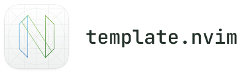

<picture>
  <source media="(prefers-color-scheme: dark)" srcset="assets/template-wordmark-dark.svg">
  <source media="(prefers-color-scheme: light)" srcset="assets/template-wordmark-light.svg">
  
</picture>

A minimal Lua Neovim plugin starter with a command, a public function, and unit tests.
There are no runtime dependencies. Nix supplies development tools and Plenary for tests.

## Get Started

### Installation

Replace `OWNER` with the GitHub owner of your copy of this template.

#### LazyVim

Create `~/.config/nvim/lua/plugins/template.lua` with this
[plugin spec](https://www.lazyvim.org/configuration/plugins):

```lua
return {
  {
    "OWNER/template.nvim",
    cmd = "HelloWorld",
    opts = {},
  },
}
```

#### Nixvim

Add this to your [Nixvim configuration](https://nix-community.github.io/nixvim/user-guide/faq.html#how-do-i-use-a-plugin-not-packaged-in-nixpkgs).
Replace `REVISION` with a commit hash and `SHA256` with its Nix source hash.
For NixOS or Home Manager, put these options under `programs.nixvim`.

```nix
{ pkgs, ... }:
{
  extraPlugins = [
    (pkgs.vimUtils.buildVimPlugin {
      pname = "template.nvim";
      version = "unstable";
      src = pkgs.fetchFromGitHub {
        owner = "OWNER";
        repo = "template.nvim";
        rev = "REVISION";
        hash = "SHA256";
      };
    })
  ];

  extraConfigLua = ''
    require("template").setup({})
  '';
}
```

#### Local Checkout

From the repository root:

```sh
nvim --clean --cmd "set runtimepath+=."
```

### Usage

Run `:HelloWorld` to display `Hello, world!`. Setup is optional:

```lua
require("template").setup({
  message = "Hello, world!",
})
```

Each `setup()` resets omitted options to their defaults.

The Lua module exposes `hello()` and `add(a, b)`:

```lua
local template = require("template")

template.hello()

-- Add two numbers and return the sum.
local sum = template.add(2, 3)
assert(sum == 5)
```

## Development

Requires [Nix](https://nixos.org/download/#nix) with the
[`nix-command` and `flakes` experimental features enabled](https://wiki.nixos.org/wiki/Flakes#Enabling_flakes_permanently).

From the repository root:

```sh
# Install the pre-commit hook.
git config core.hooksPath .githooks

# Open your existing Neovim with the local plugin loaded and configured.
nix run .#dev

# Run the Plenary/Busted unit tests.
nix run .#test

# Generate the help file and tags from this README.
nix run .#docs

# Format Lua files.
nix fmt

# Check Lua formatting without changing files.
nix fmt -- --check
```

The development launcher preserves your normal Neovim configuration and supplies
Neovim if it is not installed. Restart after code changes.
Plenary is only needed for tests.

The pre-commit hook checks formatting, runs tests, and regenerates help.
If it updates the help file, stage `doc/template.txt` and commit again.
Nix flakes in a Git checkout only include files added to Git; add new template
files before running the commands above. To try an untracked checkout, use
`nix run path:.#test` or `nix run path:.#formatter.aarch64-darwin -- --check`
(replace the system name when using another platform).

### Structure

```text
lua/template/init.lua       Public API and configuration
plugin/template.lua        HelloWorld command registration
tests/minimal_init.lua     Isolated test setup
tests/template/add_spec.lua Unit tests for add(a, b)
flake.nix                  Development, tests, docs, and formatting
.githooks/pre-commit        Checks before committing
.stylua.toml               Lua formatting rules
doc/template.txt           Generated Neovim help
```

### Make It Yours

Rename `lua/template/`, `plugin/template.lua`, the `template` module references,
the `loaded_template` guard, and the `HelloWorld` command to match your plugin.
Update the flake names, test paths, documentation project name, hook help path,
README, and license notice as appropriate. Regenerate help after editing the README.

## License

MIT. See [LICENSE](LICENSE).
